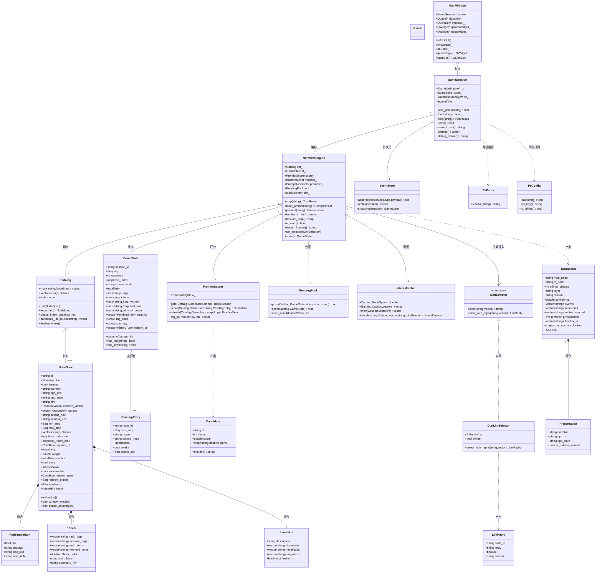
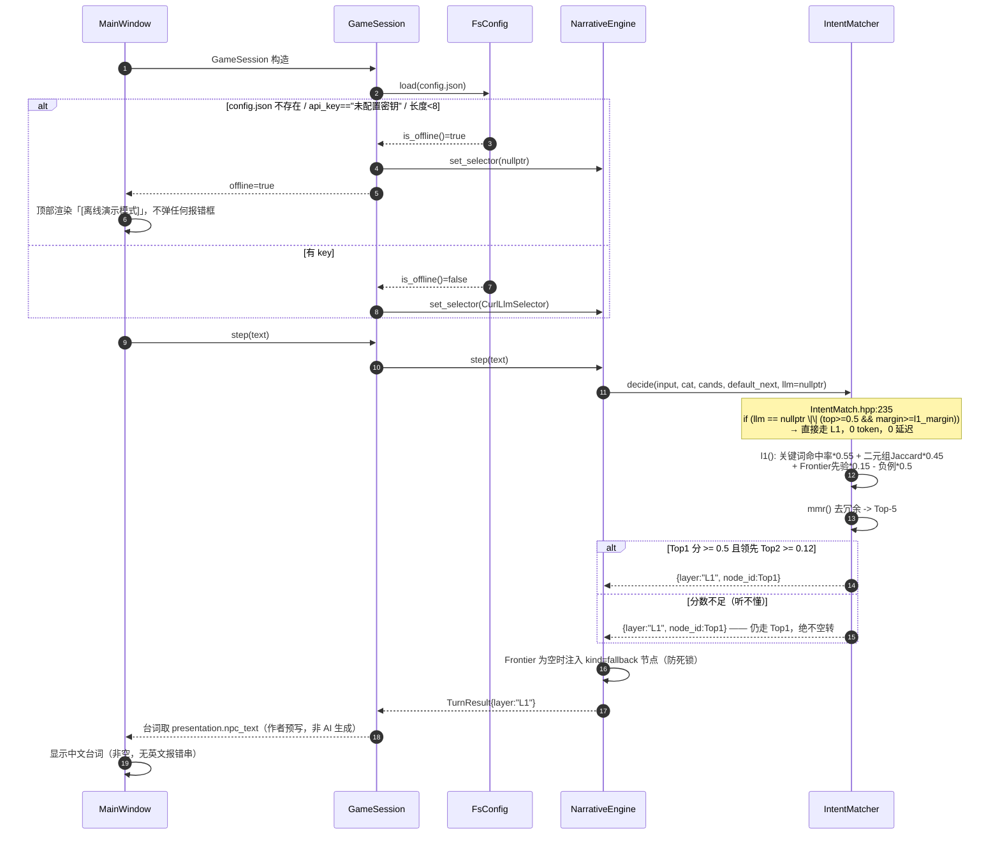
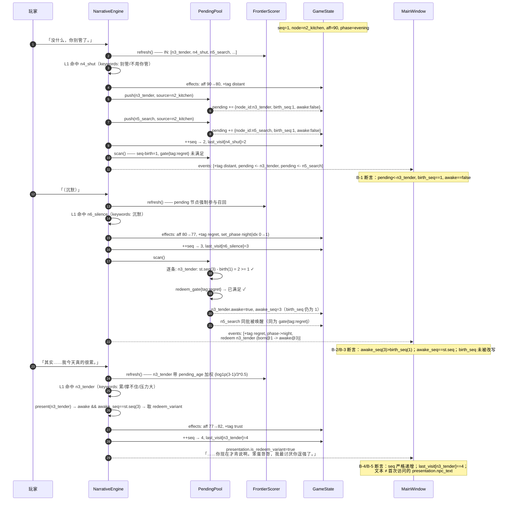
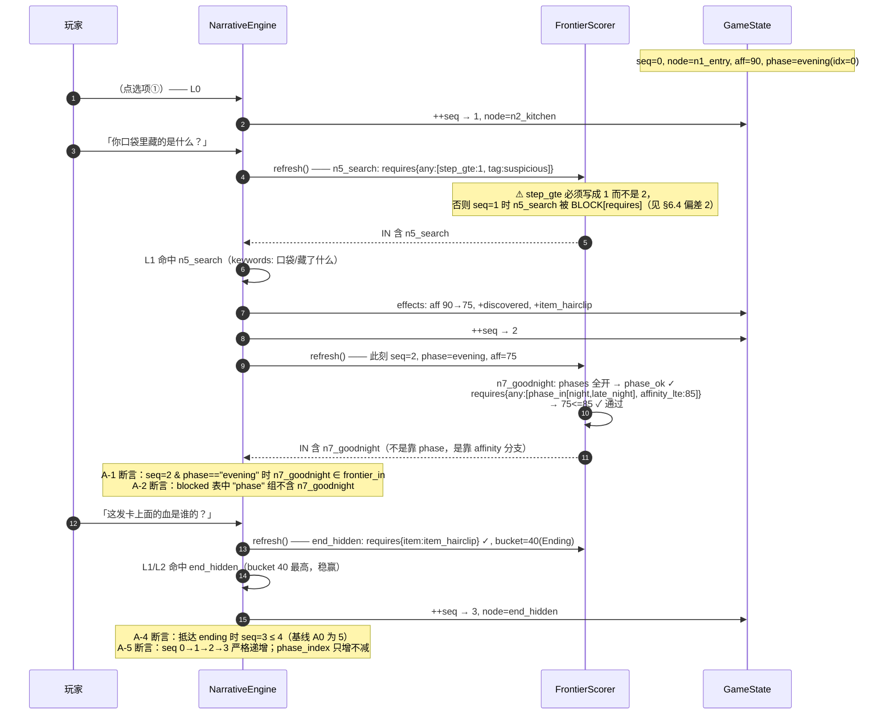
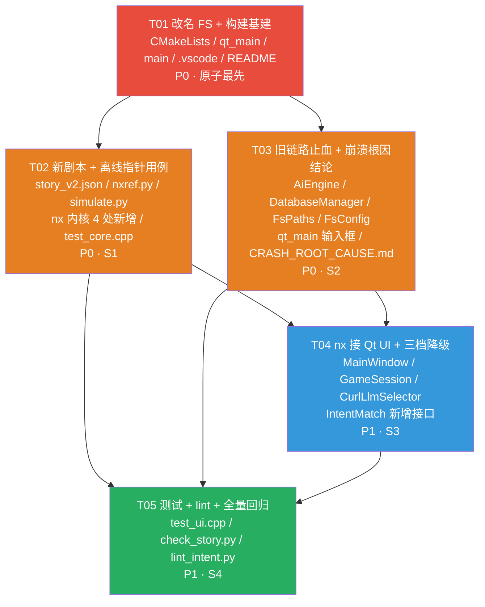

# FS 系统架构设计 + 任务分解

| 项 | 内容 |
|---|---|
| 文档语言 | 简体中文 |
| 项目名 | **FS**（内部全称 FluidStory） |
| 文档类型 | 系统架构设计 + 任务分解（Architect 交付物） |
| 版本 / 日期 | v1.0 / 2026-10-30 |
| 作者 | 高见远（架构师） |
| 上游输入 | `docs/PRD_FS_SCRIPT.md`（许清楚）、甲方已拍板决策（team-lead 转述） |
| 阅读对象 | 开发工程师、测试、产品经理 |

> **本文的立场**：不推倒重写 nx 内核。所有对 `engine/include/nx/` 的改动都标注为「新增」或「修改」，且必须与 `reference/nxref.py`（Python 预言机）**同步改动**，否则 24/24 一致性会破裂。

---

## 0. 一句话总览

> 先把项目身份统一为 **FS**（含目录改名 + 重建 build），再用 **nx 内核 + `data/story_v2.json`** 写新剧本并在 **Python 离线仿真**里把两个指针用例跑成断言，然后 **旧链路止血**（中文/崩溃/SQL/输入框），最后把 **NarrativeEngine 接进 Qt UI**，三档降级（L0 按钮 / L1 本地语义 / L2 LLM 受限选择）。

---

## 1. 实现方案与选型

### 1.1 核心技术难点

| # | 难点 | 我的处理 |
|---|---|---|
| N-1 | 旧 `GameEngine` 是 `current_node → intent_nodes` 静态白名单，**结构上无法表达前向/后向指针** | 主线走 nx 内核；旧引擎保留为 A/B 回退开关 `FS_ENGINE=v1`（默认 `v2`） |
| N-2 | 无 API key 时剧情走不动 | 三档降级；无 key 时 `llm_ == nullptr`，`IntentMatcher::decide` **天然**走 L1（`IntentMatch.hpp:235` 已实现），台词全部由作者预写 |
| N-3 | Qt UI 逻辑全在 `main()` 里（433 行单体），不可测、不可复用 | 抽出 `src/ui/MainWindow.{h,cpp}`；`src/qt_main.cpp` 瘦身为 15 行 |
| N-4 | 目录改名会破坏 `build/CMakeCache.txt` 里的绝对路径 | 改名**一次性做完**并 `rm -rf build` 重建（见 §3） |
| N-5 | 崩溃根因未知，甲方猜测（"剧情太少"）不成立 | 用 ASan + gdb **取证**，逐一排除 4 个候选，产出《崩溃根因结论》（T03 硬交付） |
| N-6 | 7 节点图的"提前量"理论上限只有 1~2 步 | 接受 1~2 步；用"整局步数 5→3 + Frontier IN 列表可断言"呈现（见 §5.6 Q-5 处置） |
| N-7 | PRD 剧本规格中存在 **3 处会直接让指针用例失败的结构冲突** | 已在 §4.4 全部定位并给出固化修正方案（**本文最重要的发现**） |

### 1.2 技术选型（沿用现有栈，不引入新依赖）

| 层 | 选型 | 理由 |
|---|---|---|
| 语言/标准 | C++17（CMake `CXX_STANDARD 17`） | 现有内核用 `std::function`/`optional` 级特性，无需升级 |
| GUI | Qt5 5.15.3 Widgets + Concurrent | 已装；VM 有 `offscreen` 后端可 headless 测 |
| HTTP | libcurl（同步 + `CURLOPT_TIMEOUT`） | 已装；不需要引入 Qt Network 双栈 |
| 持久化 | SQLite3（旧 `save.db`）+ `persistence/EventStore` 事件表 | 过渡期**只让 nx 侧写状态**，Qt 只读；S4 统一 |
| JSON | vendored `include/json.hpp` (nlohmann v3.10.1) | 只有 `StoryLoader` 依赖它，边界干净 |
| 预言机 | `reference/nxref.py`（Python 标准库） | 无依赖，可在无 Qt/curl/key 环境断言 |
| 内存取证 | GCC `-fsanitize=address` + gdb | GCC 11.4 自带 libasan，无需额外安装 |

### 1.3 架构分层

```
┌──────────────────────────────────────────────────────────┐
│  UI 层        src/qt_main.cpp  →  src/ui/MainWindow       │
│               （只做 QApplication + 显示 MainWindow）      │
├──────────────────────────────────────────────────────────┤
│  会话层（新增）src/engine/GameSession                      │
│               NarrativeEngine + EventStore + 存档/读档     │
│               + 引擎回退开关 FS_ENGINE=v1/v2               │
├──────────────────────────────────────────────────────────┤
│  适配层（新增）src/engine/CurlLlmSelector : ILlmSelector    │
│               包 include/AiEngine.h（L2）；无 key → nullptr │
├──────────────────────────────────────────────────────────┤
│  内核层（沿用）engine/include/nx/{Frontier,PendingPool,     │
│               IntentMatch,NarrativeEngine,StoryLoader}     │
│               ⚠ 零 Qt/curl/sqlite 依赖，可单测             │
├──────────────────────────────────────────────────────────┤
│  数据层       data/story_v2.json（新）/ story.json（旧）    │
│               persistence/ 事件表 + data/save.db（旧）      │
└──────────────────────────────────────────────────────────┘
```

### 1.4 三档降级如何组织

| 档位 | 触发条件 | 选路 | 台词 | 实现位置 |
|---|---|---|---|---|
| **L0 按钮档** | 玩家点选项按钮 / 输入是纯数字序号 | `NarrativeEngine::match_option()`（已实现，**排在三级漏斗之前**） | `presentation.npc_text` | 已存在，**无需改动** |
| **L1 本地语义档** | `llm_ == nullptr`（无 key / key 无效 / 超时 / 返回不在白名单 / 抛异常） | `IntentMatcher::l1()` + `mmr()` | `presentation.npc_text` | 已存在（`IntentMatch.hpp:235`），**无需改动** |
| **L2 LLM 受限选择** | 有 key 且网络通 | `llm->select()`，返回值必须在 `shortlist`（= `routes_injected`）内，否则回落 L1 | LLM `reply`；为空则回落预写台词 | **新增** `CurlLlmSelector` |

**离线模式探测**（新增 `FsConfig`，改 `AiEngine.h`）：
```
api_key 缺失 / == "未配置密钥" / 长度 < 8   →  offline = true
config.json 不存在                          →  offline = true
最近一次 L2 调用连续 3 次失败               →  offline = true（会话内降级，不弹窗）
```
`offline == true` 时 `engine.set_selector(nullptr)`，UI 顶部渲染一行半透明 `[离线演示模式]`。

---

## 2. 改名清单与执行顺序（R-01）

### 2.1 破坏面分析：为什么"改名"可以放在最前面

**关键事实**：项目内所有数据路径都是**相对路径**（`"../data/story.json"`、`"../data/save.db"`、`"../assets/bg.jpg"`），与目录名**完全无关**。

所以改名真正会破坏的只有 4 处**绝对路径/外部引用**：

| # | 破坏点 | 症状 | 处置 |
|---|---|---|---|
| 1 | `build/CMakeCache.txt` 记录绝对源码目录 | 目录改名后 `cmake --build` 报 `The current CMakeCache.txt ... is different than the directory ... where CMakeCache.txt was created` | **`rm -rf build` 后重新 `cmake -S . -B build`** |
| 2 | VS Code Remote-SSH 打开的 `${workspaceFolder}` | 打开的目录消失，断点/任务全部失效 | 关闭窗口 → 重新用新路径连接 |
| 3 | ssh / scp 命令里的路径 | 命令报 `No such file` | 全部替换为 `/home/cyc/fs` |
| 4 | Windows 侧目录被进程占用（VS Code / 资源管理器 / 杀软 / 已运行的 exe） | `Permission denied` 或改到一半失败 | **先关闭所有占用进程再改** |

**结论：改名必须最先做（T01），且一次性做完（含 build 重建）。**

理由：
1. 越晚改，Win/Ubuntu 两侧路径分叉越久，`scp`、`.vscode/launch.json`、调试配置要改两遍，反而更容易出错；
2. 改名的验证成本极低（重建 build + 跑一次 `python reference/simulate.py`）；
3. 改名**不阻塞 S1**——S1 只动 `data/` 与 `reference/`，与目录名无关；
4. 反过来，若放到最后，S2~S4 期间所有文档/脚本/脑内路径都要"新旧对照"，认知负担最大。

### 2.2 改名清单（Checklist，逐项打勾）

**A. 目录**
- [x] Windows：`D:/2026-10-30-16-55-07/fs` ✅
- [x] Ubuntu：`/home/cyc/fs` ✅（Ubuntu 侧原目录名为 `FluidStory`，已 `mv` 为 `fs`）

**B. CMake（`CMakeLists.txt`）**
- [x] `project(NarrativeX)` → `project(FS)`
- [x] `add_executable(nx_terminal src/main.cpp)` → `fs_terminal`
- [x] `add_executable(fluidstory src/qt_main.cpp)` → `fs`
- [x] `target_link_libraries(fs_terminal sqlite3 curl)`、`target_link_libraries(fs Qt5::Widgets Qt5::Concurrent sqlite3 curl)`
- [x] 新增 `include_directories(engine/include persistence/include)`（接 nx 必需）— **已于 T01 提前就位**（原计划推到 T05 是排期错误，见下方论证）
- [ ] 新增可选 target `fs_tests`（Qt Test，T05 用）— T05 做即可

> **重名冲突风险已排除（架构师复核）**。工程师担心 `engine/include` 与现有 `include/` 冲突，实际枚举结果：
> - `engine/include/` = `nx.hpp` + `nx/{Condition,Frontier,GameState,IntentMatch,NarrativeEngine,NodeModel,PendingPool,PromptAssembler,StoryLoader,Types}.hpp`
> - `persistence/include/` = `nx/EventStore.hpp`（**唯一一个文件**）
> - 现有 `include/` = `AiEngine.h` / `DatabaseManager.h` / `GameEngine.h` / `SecurityFilter.h` / `TrieFilter.h` / `json.hpp`
>
> **三方零同名**：`include/` 下既没有 `nx.hpp` 也没有 `nx/` 子目录，两个 `nx/` 目录之间也没有同名文件。
> 所以同时加入 include 路径不会产生任何歧义（`#include "nx.hpp"` → engine，`#include "nx/EventStore.hpp"` → persistence）。
>
> **为什么不能推到 T05**：T04 的 `GameSession` / `CurlLlmSelector` 必须 `#include "nx.hpp"`，而 T05 依赖 T04。
>
> **已由工程师用编译探针实测确认（T01 内完成）**：
> ```bash
> g++ -std=c++17 -fsyntax-only -I engine/include -I persistence/include -I include t04_probe.cpp
> === EXIT: 0 ===        # 零错误零警告（-Werror 级别）
> ```
> 探针同时 include 了 `nx.hpp` / `nx/EventStore.hpp` / `GameEngine.h` / `json.hpp` 并实例化 `nx::NarrativeEngine` 与 `nx::EventStore`，
> `-H` 解析归属四条全部落到预期目录。T04 拿到 `NarrativeEngine` / `ILlmSelector` 的路径已打通。
>
> ⚠️ **构造签名（探针踩过，T04 别再踩）**：
> `NarrativeEngine(Catalog, GameState, ...)` **至少两实参，无默认构造**；`EventStore(const std::string&)` 需传 db 路径。
> 写 `nx::NarrativeEngine eng{}` / `nx::EventStore store{}` 会报错，**那不是 include 问题**。
> 另：`EventStore(const EventStore&) = delete`（`EventStore.hpp:70`）→ **`GameSession` 只能持有指针/引用，不能按值拷贝**。
> `EventStore` 内部用 sqlite3，`fs` 与 `fs_terminal` 两个 target 都已 `target_link_libraries(... sqlite3 ...)`，无需再加链接项。
> 若 T05 才加 include 路径，T04 根本编不过，会直接打破"每步之后工程仍能编译"的红线。
- [x] 保留 `set(CMAKE_BUILD_TYPE Debug)`（带 `-g`，gdb 需要）；已改为 `if(NOT CMAKE_BUILD_TYPE) set(... Debug) endif()`

**C. 源码字符串**
- [x] `src/qt_main.cpp:42` 窗口标题 → `FS · FluidStory`
- [x] `src/qt_main.cpp:70` 主菜单大标题 → `FS`（副标题 `FluidStory Demo`）
- [x] 所有 `QMessageBox` 标题 → 前缀 `FS · `（`FS · 系统` / `FS · 警告` / `FS · 启动失败` / `FS · 删除存档`）
- [x] `src/main.cpp` 终端菜单标题 `🌸ISOLATE 🌸` → **`🌸 FS 🌸`**（架构师裁定：维持 team-lead 给的值，不统一成 `FS · FluidStory`。理由见下方"标题口径"）
- [x] 终端与 GUI 的系统消息统一加 `【FS】` / `FS · ` 前缀（team-lead 补充要求，已并入本清单）

> **标题口径（架构师裁定，不再变更）**：
> - **GUI 窗口标题** = `FS · FluidStory`（PRD R-01 验收项查的是窗口标题）
> - **GUI 主菜单大标题** = `FS`（副标题 `FluidStory Demo`）
> - **终端 banner** = `🌸 FS 🌸`（保留原 `🌸ISOLATE 🌸` 的 emoji 风格）
> - **所有 `QMessageBox` 标题** = `FS · xxx`
> - **系统消息前缀** = `【FS】`
>
> 终端 banner 与 GUI 窗口标题**属不同上下文、不必同字面**；两者都含 `FS`，R-01 验收通过。
> 后续任何人不要再为了"统一"去改终端 banner——改一次要重新 scp + 重建，纯浪费。
- [ ] `src/main.cpp:27` 剧本路径 `"../data/story.json"` → `"../data/story_v2.json"`（改引擎后）— **后续剧本迁移任务再做**

**D. `.vscode/`**
- [x] `launch.json`：配置名 `① 调试 fs_terminal`、`② 调试 fs（Qt GUI · offscreen）`、`④ 附加`；`program` 改 `${workspaceFolder}/build/fs_terminal` / `build/fs`；`preLaunchTask` 改 `构建 fs_terminal` / `构建 fs`；注释里的路径已改为 `/home/cyc/fs`
- [x] `tasks.json`：任务 label 已改为 `构建 fs_terminal` / `构建 fs`；`全部构建`、`CMake 配置`、`回归验证` 不变
- [ ] `c_cpp_properties.json`：`compilerArgs` 保持 `-std=c++17`；`includePath` 补 `${workspaceFolder}/src`（新增 UI/会话层后）
- [ ] 新增一个 launch 配置 `⑤ 调试崩溃复现（ASan 版）`，指向 `build/fs_terminal_asan`

**E. 文档**
- [x] `README.md`：全量替换路径与 target 名（新增「构建与运行」小节，写明 `fs_terminal` / `fs` 两个 target）
- [x] `docs/PROJECT_PLAN.md`、`docs/FEASIBILITY_REVIEW.md`：路径与 target 名已更新；品牌名 `NarrativeX` 保留为"内核代号"说明（PRD R-01 验收④允许注释/文档保留品牌说明）
- [x] 本文 `docs/ARCH_FS.md` 内的路径

**F. 验收命令（两侧各跑一遍）**
```bash
grep -rn "NarrativeX" src/ CMakeLists.txt        # 仅剩注释
ls build/fs build/fs_terminal                     # 两个可执行文件
grep -rn "FluidStory\|FS" src/qt_main.cpp | head  # 标题唯一
```

### 2.3 不可中断的原子操作顺序（严格按序执行）

> ⚠️ 中途停下会留下"一边 `fs` 一边旧名"的分叉状态。请一次性跑完 R1→R8。

| 步 | 位置 | 操作 |
|---|---|---|
| **R1** | 两侧 | 关闭所有占用进程：VS Code 全部窗口（含 Remote-SSH）、已运行的 `fs`/`fs_terminal`、资源管理器停留在项目目录的窗口 |
| **R2** | Ubuntu | `ssh ... ubuntu "pkill -f '[f]luidstory'; pkill -f '[n]x_terminal'; cd /home/cyc && mv FluidStory fs && rm -rf fs/build && ls fs"` ⚠️ `pkill -f` 的模式会匹配到远端 shell 自身，必须写成 `'[f]luidstory'` 这种形式 |
| **R3** | Windows | 重命名目录 `fs`；删除 `build/`（若存在） |
| **R4** | Windows | 按 §2.2 B/C/D/E 修改全部文件内容（`CMakeLists.txt`、`src/*`、`.vscode/*`、`README.md`） |
| **R5** | Windows→VM | `scp -F /d/SSH_config/conifg` 同步**改动过的文本文件**（不要全量传；VM 侧内容已由 R2 的 mv 就位） |
| **R6** | Ubuntu | `ssh ... ubuntu "cd /home/cyc/fs && cmake -S . -B build -DCMAKE_BUILD_TYPE=Debug -DCMAKE_EXPORT_COMPILE_COMMANDS=ON && cmake --build build -j2 && ls build"` |
| **R7** | Ubuntu | `ssh ... ubuntu "cd /home/cyc/fs && python3 reference/simulate.py"` → 必须仍 24/24（证明改名未破坏离线验证路径） |
| **R8** | 两侧 | 更新 `.vscode` 后重新用 VS Code 打开 `/home/cyc/fs`；跑一次 `构建 fs_terminal` 确认 F5 链路可用 |

**回滚预案**：任何一步失败 → 把 `fs` 目录名改回原目录名（Windows 侧原名为下载包解压目录；Ubuntu 侧原名为 `FluidStory`，即 `mv fs FluidStory`）+ 恢复 build/（重新 cmake）。因为改名未触及任何业务逻辑，回滚是安全的。

---

## 3. 文件清单

### 3.1 新增

| 路径 | 用途 | 所属任务 |
|---|---|---|
| `data/story_v2.json` | **正式新剧本**（1000 字 / 50~70 句 / 7 对话节点 / 3 结局）。`story_v2.example.json` 保持为格式样例不动 | T02 |
| `include/FsPaths.h` | 统一数据路径解析（从 `GameEngine::resolve_data_path` 提取复用），支持 build/ 与项目根两种 cwd | T03 |
| `include/FsConfig.h` | `config.json` 读取 + 离线档探测（api_key 有效性判断集中在此，消灭 `AiEngine.h` 里的硬编码） | T03 |
| `src/ui/MainWindow.h` / `src/ui/MainWindow.cpp` | 从 `qt_main.cpp` 抽出的 UI 类；暴露 `gamePage()`/`inputBox()` 等供 Qt Test 访问 | T04 |
| `src/engine/GameSession.h` / `.cpp` | 会话层：`NarrativeEngine` + `EventStore` + 存档；`FS_ENGINE` 回退开关工厂 | T04 |
| `src/engine/CurlLlmSelector.h` / `.cpp` | `ILlmSelector` 的 curl 实现（L2），内部调改造后的 `AiEngine` | T04 |
| `tools/check_story.py` | 剧本体检：字数/句数/节点计数/结局穷尽性 lint（R-05 验收①~④） | T05 |
| `tools/lint_intent.py` | `intent.description` lint：相似度 ≥0.85 报冲突、缺 keywords/examples/negatives 报警、含节点 ID 报错（R-12） | T05 |
| `tests/test_ui.cpp` | Qt Test 交互测试（T-01~T-12 的可自动化子集） | T05 |
| `reference/cases_pointer.py` | 前向/后向指针用例 + 对照组，被 `simulate.py --case` 调用 | T02 |
| `docs/CRASH_ROOT_CAUSE.md` | **《崩溃根因结论》**（R-03 硬交付） | T03 |
| `scripts/build_asan.sh` | ASan 构建脚本（崩溃复现用） | T03 |
| `config.json.example` | 配置文件样例（含 `api_key` 占位），便于甲方填 key | T04 |

### 3.2 修改

| 路径 | 改动要点 | 类型 |
|---|---|---|
| `CMakeLists.txt` | 改名 + 新增 `engine/include`、`persistence/include` include 路径 + `fs_tests` target | 改 |
| `src/qt_main.cpp` | 瘦身为 `QApplication` + `MainWindow`；窗口标题 `FS · FluidStory` | 改 |
| `src/main.cpp` | 终端入口改名；切到 `story_v2.json`；`FS_ENGINE` 开关；加 `--selftest` | 改 |
| `include/AiEngine.h` | ① 删除 `c>=32&&c<=126` 暴力清洗（**R-02**）；② 新增 `analyze_route()`（返回 `{node_id, reply}`，供 L2）；③ api_key 改由 `FsConfig` 注入 | 改 |
| `include/DatabaseManager.h` | 全部 SQL 改 `sqlite3_bind_*`（**R-11**） | 改 |
| `include/GameEngine.h` | 仅保留必要改动：`resolve_data_path` 迁出到 `FsPaths.h` 后改调它；其余**不动**（回退链路） | 改（小） |
| `engine/include/nx/NodeModel.hpp` | **新增** `NodeSpec::redeem_variant`（`{narrator, npc_text, npc_state, has}`）（R-10） | 增 |
| `engine/include/nx/StoryLoader.hpp` | **新增** `presentation.redeem_variant` 解析；`lint()` 增补"结局穷尽性"与"phase.allow 与 requires 双重约束"告警 | 改 |
| `engine/include/nx/NarrativeEngine.hpp` | **新增**：`present()`、`frontier_in_ids()`、`blocked_map()`；`TurnResult` 增 `presentation` / `frontier_in` / `blocked` 三个字段（全部是**新增**，不改既有字段） | 改 |
| `engine/include/nx/IntentMatch.hpp` | **新增** `ILlmSelector::select_with_reply()`（`select()` 保留，默认实现转发，不破坏既有测试） | 改 |
| `reference/nxref.py` | **同步**上述 4 处内核改动（redeem_variant / present / frontier_in_ids / blocked_map），保持 oracle 等价 | 改 |
| `reference/simulate.py` | 加 `--case forward_pointer \| backward_pointer \| backward_pointer_neg` 与 `--story` 参数 | 改 |
| `README.md` / `.vscode/*` | 改名 | 改 |

### 3.3 删除 / 清理（P2，不阻塞）

| 路径 | 说明 |
|---|---|
| `engine/tests/test_core.exe`、`engine/tests/a.txt`、`engine/tests/b.txt` | 误提交产物 |
| `data/items.json` | 0 字节空文件；旧引擎未实际读取（确认后删） |
| `data/story.json` | **保留**：`FS_ENGINE=v1` 回退链路仍需它，S4 后再议 |

---

## 4. 数据结构与接口

### 4.1 类图（Mermaid）



### 4.2 关键接口契约（新增部分，逐条）

#### (1) `NodeSpec::redeem_variant`（**新增**，`NodeModel.hpp`）

```cpp
struct RedeemVariant {
    bool   has = false;
    std::string narrator, npc_text, npc_state;
};
// NodeSpec 内新增成员： RedeemVariant redeem_variant;
```

#### (2) `NarrativeEngine::present()`（**新增**）

```cpp
struct Presentation {
    std::string narrator, npc_text, npc_state;
    bool is_redeem_variant = false;   // true = 用的是 redeem_variant 文本
};

// 判定：st_.pending 中存在 node_id==id && awake && awake_seq == st_.seq
//      且该节点 redeem_variant.has == true  → 用变体
//      否则回落 presentation；回落时 is_redeem_variant=false
Presentation present(const NodeId& id) const;
```

#### (3) `frontier_in_ids()` / `blocked_map()`（**新增**，服务于 A-1/A-2/A-3/B-6 的结构化断言）

```cpp
std::vector<NodeId> frontier_in_ids() const;   // refresh() 后已进入的节点，按排序返回
std::unordered_map<std::string, std::vector<NodeId>> blocked_map() const;  // reason -> ids
```
> **为什么必须新增**：`debug_frontier()` 只产出人类可读字符串（`IN    [n7_goodnight] bucket=... score=...`）。若断言靠 `grep` 文本，"BLOCK[phase] n7_goodnight" 这种子串匹配极易误判（节点名是另一个节点名前缀时会误命中）。给结构化 API，Python 侧与 C++ 侧断言同一份数据。

#### (4) `TurnResult` 新增 3 个字段（**只增不改**）

```cpp
Presentation presentation;                                  // 本步应呈现的文本
std::vector<NodeId> frontier_in;                             // 本步 refresh 的 IN 列表
std::unordered_map<std::string, std::vector<NodeId>> blocked;// 本步 BLOCK 原因表
```

#### (5) `ILlmSelector::select_with_reply()`（**新增**，`select()` 保留）

```cpp
struct LlmReply { NodeId node_id; std::string reply; bool ok=false; std::string reason; };
virtual LlmReply select_with_reply(const std::string& user_input,
                                   const std::vector<Candidate>& shortlist) {
    LlmReply r; r.node_id = select(user_input, shortlist); r.ok = !r.node_id.empty(); return r;
}
```
> 保留旧 `select()` 纯虚函数不变，`test_core.cpp` 与 `nxref.py` 的 StubLLM 无需改动。

#### (6) `GameSession`（**新增**，会话层）

```cpp
class GameSession {
public:
    bool new_game(const std::string& player);   // 建 GameState + 写 EventStore
    bool load(const std::string& player);       // 从 EventStore 快照恢复（S4）；过渡期读 save.db
    nx::TurnResult step(const std::string& input);
    bool save();
    bool is_over() const;
    bool is_offline() const;
    std::vector<std::string> options() const;   // 当前节点 options 文本
    std::string debug_frontier() const;
};
```

---

## 5. 调用流程

### 5.1 流程 ①：L2 档（有 key）主流程

```mermaid
sequenceDiagram
    autonumber
    participant U as 玩家
    participant MW as MainWindow
    participant GS as GameSession
    participant NE as NarrativeEngine
    participant FS as FrontierScorer
    participant IM as IntentMatcher
    participant LL as CurlLlmSelector
    participant AE as AiEngine
    participant ES as EventStore

    U->>MW: 输入中文「你口袋里藏了什么」+ 点发送
    MW->>MW: showInput() 收起输入框, 发送按钮禁用
    MW->>GS: step(text)
    GS->>NE: step(user_input)
    NE->>FS: refresh(cat, st) —— 干净的 Frontier
    FS-->>NE: FrontierView{items, blocked}
    NE->>NE: match_option(input, cur) —— L0 快判
    alt 命中选项序号
        NE-->>GS: TurnResult{layer:"L0"}
    else 未命中
        NE->>IM: decide(input, cat, cands, default_next, llm)
        IM->>IM: l0() 关键词强命中且无歧义?
        alt L0 独占命中
            IM-->>NE: IntentDecision{layer:"L0"}
        else 进入 L1 打分
            IM->>IM: l1() + mmr() -> shortlist(5)
            IM->>LL: select_with_reply(input, shortlist)
            LL->>AE: analyze_route(input, routes_injected)
            AE->>AE: HTTP POST (curl, timeout 10s)
            AE-->>LL: {node_id, reply}
            LL-->>IM: LlmReply{node_id, reply, ok}
            alt node_id 在 shortlist 白名单内
                IM-->>NE: IntentDecision{layer:"L2", confidence:1.0}
            else 幻觉 / 超时 / 异常
                IM-->>NE: IntentDecision{layer:"L1", reason:"已降级"}
            end
        end
    end
    NE->>NE: 应用 effects(tags/items/affinity/phase)
    NE->>NE: 兄弟节点压入 PendingPool(alts)
    NE->>NE: ++st.seq; last_visit/visited/current_node 更新
    NE->>NE: pool_.scan() —— 后向指针唤醒
    NE-->>GS: TurnResult{to_node, events, presentation, frontier_in, blocked}
    GS->>ES: append(session, seq, "TURN", state_json) —— 单一事务
    ES-->>GS: ok
    GS-->>MW: TurnResult
    MW->>MW: dialogBox->setText(presentation.npc_text)
    MW->>MW: refreshUI() —— 渲染选项 + 唯一的自由输入按钮
```

### 5.2 流程 ②：L1 降级流程（无 key / 超时 / 幻觉）



> **有 key 但运行中失败的降级**：`CurlLlmSelector` 内部连续失败 3 次 → 置 `offline_=true` 并向上层返回 `ok=false`，`IntentMatcher` 捕获后回落 L1；UI 顶部**静默**加 `[离线演示模式]`，**不弹窗**（R-08 验收①）。

### 5.3 流程 ③：后向指针 —— 事件挽回（用例 B）



### 5.4 流程 ④：前向指针 —— 未来节点被提前拉进可达集合（用例 A）



---

## 6. 剧本文件数据契约（`data/story_v2.json`）

### 6.1 顶层字段

```jsonc
{
  "phases": ["evening", "night", "late_night"],   // 有序，索引即时间进度
  "entry": "n1_entry",
  "frontier": { ... },    // 沿用 story_v2.example.json 数值，不改
  "intent":   { ... },    // 沿用，不改
  "budget":   { ... },    // 沿用，不改
  "nodes":    { ... }
}
```

### 6.2 节点字段契约

| 字段 | 类型 | 必填 | 说明 |
|---|---|---|---|
| `kind` | string | ✓ | `scripted` / `emergent` / `redemption` / `ending` / `fallback` |
| `terminal` | bool | — | `true` 永不进 Frontier（`-1` 必须 true） |
| `presentation.narrator` | string | ✓ | 旁白 |
| `presentation.npc_text` | string | ✓ | 她说的台词（**离线档台词来源**） |
| `presentation.npc_state` | string | — | 注入 `{NPC_STATE}` |
| `presentation.hint` | string | — | 提示 |
| `presentation.redeem_variant.{narrator,npc_text}` | object | 可挽回节点 **必须** | 挽回变体（R-10） |
| `options[]` | array | — | `{text, next}`；**禁止**写 `【自由输入】` 选项 |
| `default_next` / `fallback_next` | string | ✓ | lint 校验目标存在 |
| `window.{min_step,max_step}` | int | — | 生命周期窗口 |
| `phase.allow` | string[] | — | ⚠ **见 §6.4 偏差 1：对话节点一律全开** |
| `requires` | cond | — | 准入条件（DSL 见下） |
| `priority` / `weight` / `once` / `cooldown` | — | — | 排序参数 |
| `redeemable` / `redeem_gate` / `redeem_expire` | — | — | 后向指针三件套 |
| `effects.{add_tags,add_items,affinity_delta,set_phase,summary_hint}` | object | — | 确定性副作用 |
| `intent.{description,keywords,examples,negatives,must_freeform}` | object | ✓ | AI 接缝（lint 必查） |

### 6.3 条件 DSL（`StoryLoader::compile_cond` 已支持）

`true` / `false` / `all[]` / `any[]` / `not{}` / `tag` / `tags_all[]` / `tags_any[]` / `tag_none[]` / `item` / `items_all[]` / **`affinity_gte`** / **`affinity_lte`** / `visited` / `not_visited` / `visit_count_gte[node,n]` / `step_gte` / `step_lte` / `phase_in[]` / `phase_index_gte`。
**未知算子直接抛 `BadScript`** —— 拼错 key 不会静默恒真。

### ⚠ 条件算子命名陷阱（P0，工程师实测发现；**PRD 与本文 v1.3 之前都踩了**）

`StoryLoader::compile_cond()` 的算子表里**只有 `affinity_gte` / `affinity_lte`**，
而 `Condition.hpp:84/87` 的 **C++ 辅助函数**叫 `affinity_at_least(int)` / `affinity_at_most(int)`。
**PRD §5.2/§5.6（以及本文 v1.3 之前）全程用的是 C++ 函数名 `affinity_at_least` / `affinity_at_most`** —— 引擎不认识。

工程师做了对照实验（把 JSON 换回 PRD 的字面拼写喂给真 `StoryLoader`）：
```
=== 用 PRD §5.2/§5.6 的字面拼写加载 ===
THROW NxError: 未知条件算子: affinity_at_least
EXIT=3
```
也就是说：**照着 PRD §5.2/§5.6 抄，剧本连编译都过不去**（`StoryLoader::load` 是 fail-fast）。

**固化**：JSON 里一律用 **`affinity_gte` / `affinity_lte`**。本文 §6.4/§6.5 已全量改正。
另：`affinity_anchor`（Frontier 打分用的好感度锚点）也是由 `affinity_gte/lte` 分支里的 `deps.affinity_sum` 算出来的
（`StoryLoader.hpp:386-387`），用错算子不仅加载失败，**连打分锚点都会跟着错**。

**同类陷阱提醒**：`step_gte/step_lte`、`phase_index_gte`、`visit_count_gte` 也都是 `gte/lte` 风格；
只有 `tag`/`item`/`phase_in` 这类是单词。写剧本时以 `StoryLoader.hpp:379-402` 的算子表为准，不要凭函数名猜。

### 6.4 ⚠ 设计固化与偏差说明（本文最重要的部分）

我在把 PRD §5/§6 与 `Frontier.hpp` / `PendingPool.hpp` 逐行对齐时，发现 **5 处会直接让验收断言失败的结构冲突**。以下为固化结论，**工程师必须按此实现，不要照抄 PRD 原表**。

---

#### 偏差 1（阻断 A-1/A-2）：`phase.allow` 与 `requires` 的**双重 phase 约束**

`FrontierScorer::gate()` 的判定顺序是：

```cpp
if (!n->phase_ok(st.phase, st.phase_index)) return BlockReason::Phase;   // ← 先查硬门槛
...
if (!n->requires_fn(ctx)) return BlockReason::Requires;                  // ← 再查 requires
```

PRD §5.2 给 `n7_goodnight` 写了 `phase.allow = ["night","late_night"]`，同时 `requires = {any:[{phase_in:["night","late_night"]},{affinity_lte:85}]}`。
那么在 `seq=2, phase=evening` 时：**phase 硬门槛先把它 BLOCK 掉**，requires 里的 affinity 分支根本没机会生效 → **A-1 与 A-2 必然失败**。

**固化方案（选 P3：纯剧本侧，零内核改动）**：

> **所有 7 个对话节点的 `phase.allow` 一律写全 `["evening","night","late_night"]`（等价于不限），phase 的物理约束完全下沉到 `requires`。phase 的叙事意义（"天黑了"）由 `n6_silence.effects.set_phase = "night"` 承载，并由三个 ending 的 `requires` 消费。**

取舍说明：
- P1（放开 allow）与 P3 等价，我选 P3 因为它显式写出、可读性好；
- P2（改 `gate()` 语义：requires 含 `phase_in` 时跳过 `phase_ok`）会动内核语义，风险大，**不采用**；
- P4（`NodeSpec` 加 `phase_is_soft` 开关）是备选，若甲方坚持要保留"作者声明的 phase 门槛"作为文档价值再启用。

**连带修正（A-3）**：放开 allow 后，对照组（坦白线 `seq=2, aff=95`）的 `n7_goodnight` 不再输出 `BLOCK[phase]`，而是 `BLOCK[requires]`。
→ **A-3 固化为：「对照组在 `seq=2` 时 `n7_goodnight` ∉ `frontier_in`」**（PRD 原文已给出此备选判定，我明确采用它）。

---

#### 偏差 2（阻断用例 A 第 2 步）：`n5_search.requires` 的 `step_gte` 差一

PRD 写 `{any:[{step_gte:2},{tag:"suspicious"}]}`。但用例 A 第 2 步发起时 `st.seq == 1`（`n2_kitchen` 进入后），`step_at_least(2)` 求值为 `1 >= 2` = false → `n5_search` 被 `BLOCK[requires]` → 玩家说「你口袋里藏的是什么」会被路由到 `default_next = n6_silence`，**用例 A 根本走不起来**。

**固化方案**：`n5_search.requires = {any:[{"step_gte":1},{"tag":"suspicious"}]}`。
语义上完全自洽——"一进厨房就翻她口袋"正是要展示的激进玩法。

---

#### 偏差 3（阻断 B-5）：`n3_tender` 被挽回时 phase 已经是 `night`

用例 B 的时间线：`seq=3` 进入 `n6_silence` → `set_phase: night`（`phase_index` 0→1）。
`seq=4` 时 `n3_tender` 被挽回。若按 PRD 给 `n3_tender.phase.allow = ["evening"]`，此时 `phase_ok("night",1)` = false → `BLOCK[phase]` → **n3_tender 永远救不回来**。

**固化方案**：已在偏差 1 中一并解决（对话节点 phase 全开）。

---

#### 偏差 4（阻断"挽回翻转价值"）：结局阈值 86/80 **会让挽回线落空**

team-lead 转述 PRD 建议把 `end_calm` 提到 `affinity_gte: 86`、`end_regret` 降到 `affinity_lte: 80`（PRD 原文写作 `affinity_at_least/at_most`，是 C++ 函数名而非 DSL 算子名，见本节末尾「⚠ 条件算子命名陷阱」）。
**我明确否决这个修正**，理由是用 §5.3 的 effects 反推：

| 走法 | 最终 aff | 86/80 方案下 | 结论 |
|---|---|---|---|
| 坦白线 | 94 | ≥86 → `end_calm` ✓ | OK |
| 拒绝线·不挽回 | 79 | ≤80 → `end_regret` ✓ | OK |
| **拒绝线·挽回成功** | **84** | 84 < 86 **且** 84 > 80 → **两个结局都不满足 → 死锁** | ❌ **挽回的价值证明没了** |

而 PRD 原文的 83/82 分界下，挽回线 84 ≥ 83 → `end_calm` ✓，翻转成立，但缓冲只有 **1 点**（84 vs 83）。

**最终固化阈值（我拍板）**：

```jsonc
"end_calm":   { "kind":"ending", "priority":60,
                "requires": {"all":[ {"phase_in":["night","late_night"]},
                                     {"affinity_gte":82} ]} },
"end_regret": { "kind":"ending", "priority":90,
                "requires": {"all":[ {"any":[ {"tag":"regret"},
                                              {"step_gte":9} ]},
                                     {"affinity_lte":81} ]} },
"end_hidden": { "kind":"ending", "priority":100,
                "requires": {"item":"item_hairclip"} }
```

验算（初始 aff=90，`n3 +5`、`n4 −10`、`n5 −15`、`n6 −3`、`n7 +2`）：

| 走法 | 路径 effects | aff | 命中 | 缓冲 |
|---|---|---|---|---|
| 坦白线 A0 | +5 −3 +2 | **94** | `end_calm`（≥82 ✓，night ✓） | 12 点 |
| 拒绝线·不挽回 B0 | −10 −3 +2 | **79** | `end_regret`（≤81 ✓，regret ✓） | 2 点 |
| **拒绝线·挽回成功 B** | −10 −3 +5 +2 | **84** | `end_calm`（≥82 ✓） | **2 点** ← 翻转成立 |
| 搜身线 A | −15 +2 | **77** + 发卡 | `end_hidden`（priority 100 压过 90） | — |
| 搜身+沉默 | −15 −3 +2 | **74** + 发卡 + regret | `end_hidden`（100 > 90） | 符合叙事直觉 |

四点好处：
1. 挽回线缓冲从 1 点提到 **2 点**（84 vs 82），不挽回线也有 2 点（79 vs 81）；
2. `end_calm`(≥82) 与 `end_regret`(≤81) **在整数轴上互斥且穷尽**，不存在 82/83 那种"紧贴1点"的抖动；
3. `end_regret` 的 `any[tag:regret, step_gte:9]` 提供**收束兜底**：哪怕玩家拖到 seq≥9 还没拿到 regret 标签，只要 aff≤81 就能结束，不会卡死；
4. `affinity_lte:81` 保证 **aff≥82 时绝不会误落 `end_regret`**，坦白线不会被 priority 90 反杀。

**配套**：`n7_goodnight.fallback_next = "end_regret"`，并保留 `n_idle`（`kind:"fallback"`）作为 Frontier 空集时的最后一道防死锁闸。

**新增 lint 规则**（`tools/check_story.py`，R-05 验收⑤扩展）：三个 ending 的 `requires` 必须在 affinity 轴上**互斥且穷尽**，否则剧本拒绝加载。

---

#### 偏差 5（影响 B-2 的断言写法）：`n5_search` 会与 `n3_tender` **同时**被唤醒

`n2_kitchen` 的 options 有 3 个目标（n3/n4/n5），选了 `n4_shut` 后 `PendingPool::push` 会把**另外两条都**压入池：
`n3_tender`（gate `{tag:regret}`）和 `n5_search`（gate 同为 `{tag:regret}`）。
`seq=3` 拿到 `regret` 后，**两条一起被唤醒**。

**固化**：B-2 断言必须写成「`events` **含** `redeem n3_tender (born@1 -> awake@3)`」而不是「**仅含**」。
后续由 L1 打分决出走哪条（输入「我今天真的很累」→ `n3_tender` 的 keywords `累/撑不住` 命中，`n5_search` 的 keywords 是 `口袋/发卡` → 不命中），自然收敛到 `n3_tender`。

---

#### 偏差 6（P0，架构师补充）：**`default_next` 在离线档几乎不生效** —— 会同时打断基线 A0 与用例 B

`IntentMatcher::decide()` 在 `cands` 非空时**永远返回 `scored[0].first`**，只有在 `cands.empty()` 时才返回 `default_next`；
`NarrativeEngine::step()` 里 `NodeId next = picked.empty() ? default_next : picked;` 也只在 picked 为空时才用 `default_next`。
而离线档（`llm_ == nullptr`）走的就是 `IntentMatch.hpp:235` 那个分支 → **`default_next` 只在 Frontier 空集时才起作用**。

**含义：剧本的"推进"不是靠 `default_next`，而是靠 L1 打分。每个测试步骤的输入都必须写成能命中目标节点 keywords 的原话。**

由此派生两个必须显式处置的后果：

**(a) 基线 A0 会在第 4 步跳过 `n7_goodnight` 直达 `end_calm`**
`bucket_of(Ending)=40 > bucket_of(Scripted)=30`，且 `Frontier::refresh()` 的排序是 bucket 降序优先于 score 降序。
基线走到 `n6_silence`（seq=3，`set_phase:night`，aff=92）时，`end_calm`（`phase_in night` ✓ 且 `aff=92 ≥ 82` ✓）**已经 feasible**。
此时若第 4 步输入是中性文本（如「继续」/「……」），所有节点 kw 命中均为 0，L1 分数退化为 `prior × frontier_score`，
`end_calm`（≈1.31）会压过 `n7_goodnight`（≈0.85）→ **直接跳结局，`n7_goodnight` 被跳过，PRD 的"基线 5 步"变成 4 步，A-3 的对照组也不成立**。

**固化**：① **`n7_goodnight` 保持 4 个 keywords `["晚安","睡了","困了","回房"]` 不变**（原方案"补到 7 个"已撤回，见下方裁决）；
② 基线 A0 的第 4 步输入**固定**为「该睡了，晚安。」（命中 `晚安` + `睡了` 两个，kw=0.50）；
③ 新增断言 **A-7：基线 A0 第 4 步 `to_node == "n7_goodnight"`，抵达 ending 时 `seq == 5`**。

**(b) 用例 B 第 5 步会被 `n5_search` 抢走 → 拿到发卡 → 落 `end_hidden`，挽回翻转演示失败**
用例 B 走到 `n3_tender`（seq=4）时，`n5_search` 是 `n3_tender` 选项②的邻居 → 仍在候选里，且 priority 78 > `n7_goodnight` 的 50，
还带着唤醒后的 `pending_age` 加分。若第 5 步输入是中性文本，L1 会选 `n5_search` → `+item_hairclip` → `end_hidden`（bucket 40）无条件压过一切 → **"挽回成功 → end_calm"的证明没了**。

**固化**：① 用例 B 第 6 步（PM 的 v1.2 表：seq=4 → 5）输入**固定**为「那……晚安吧。」；
② **给 `n5_search` 加 `negatives: ["晚安","睡"]`**（架构师最终裁决，见下方"keywords 归一化裁决"）；
③ 新增断言 **B-8：该步 `to_node == "n7_goodnight"` + 全程未获得 `item_hairclip` + 最终 `to_node == "end_calm"` 且 `affinity == 84`**。

> **通用纪律**：所有指针用例的每一步输入都必须写进测试脚本并固定，不允许用「继续」这类中性文本推进剧情。
> 这一点同时要写进 `tools/check_story.py` 的说明与 PRD 测试用例表。

---

### ⚠ keywords 归一化裁决（架构师最终裁定，PM 的 M-10 成立，我原方案有误）

> 🔧 **适用范围修正（重要）**：本节的"加词摊薄"结论**只对 L1 成立**。
> `IntentMatch.hpp` 里有**两套 kw 算法**，L0 与 L1 行为相反。详见本节末尾「三层分档的 kw 算法差异」。
> 本轮离线档走 L1，所以下面的结论与终裁都成立；但**联机档（有 key）会先走 L0，结论不适用**——
> 以后做 L2/L0 联机档调参时不要照搬本节。

`IntentMatcher::l1()` 的关键词命中率是**按关键词总数归一化**的：

```cpp
kw = min(1.0, contains_count(input, n.intent.keywords) / (double)keywords.size());
s  = 0.55*kw + 0.45*sim + 0.15*c.score - 0.5*neg;
```

**加词会摊薄命中率**。我原方案给 `n7_goodnight` 从 4 词补到 7 词，代入实测：

| keywords | 输入「那……晚安吧。」 | hits/size | kw 项 | n7 总分 | 对 `n5_search`(≈0.17) 的领先 |
|---|---|---|---|---|---|
| 4 词（保持） | `晚安` | 1/4 = 0.25 | 0.1375 | ≈0.265 | **0.095** |
| 7 词（我原方案） | `晚安` | 1/7 = 0.14 | 0.079 | ≈0.206 | **0.009** ← 低于浮点噪声量级 |

**安全边际掉 10 倍，B-8 会从"稳过"变成"偶尔红"。PM 是对的，我撤回"补 keywords"。**

**为什么不选 PM 的方案②（`priority` 50→62）**：`priority` 是作者意图层的旋钮，改它会**全局改变 Frontier 排序**（n7 会越过 `n6_silence` 的 55），影响所有路径每一步，而不是只影响我们要修的那一步。用作者意图层的钝器去修一个"测试输入"层的问题，是**改错了层**。
**为什么不选方案③（输入命中 3 个词）**：会逼出「我困了，该睡了，晚安。」这种不自然的台词，污染 1000 字剧本的语感。

**最终裁定 = 方案① + 我追加的一条精准杠杆：**
> **`n7_goodnight` 保持 4 个 keywords 不变，同时给 `n5_search` 加 `negatives: ["晚安","睡"]`。**

理由：
- `neg` 项权重 **−0.5**，且**只在我们写死的那句输入上触发**（含"晚安"就扣），是**精准**而非全局的杠杆；
- 加了之后 `n5_search` 在说晚安的语境下分数变成 `0.17 − 0.5 = −0.33`，`n7` 以约 **0.6** 的绝对优势胜出（比 4 词方案的 0.095 高一个量级）；
- **语义上完全自洽**：「我要睡了／晚安」确实是「翻她口袋」的强反例信号，不是为了过测试而硬塞的 hack；
- **零全局副作用**：`negatives` 只在命中时扣分，不影响任何其它步骤的排序。

**提炼为剧本编写规则（已同步 PM 的 §7.1 规则 11）**：
> keywords 不是越多越好，**3~4 个为佳**，且必须能被同一句玩家原话同时命中 **≥2 个**；
> 想压制某个对手节点时，**优先给对手加 `negatives`，而不是给自己加 keywords、更不要动 `priority`。**

---

#### 📐 三层分档的 kw 算法差异（**加词摊薄只对 L1 成立**，工程师核出，架构师确认）

`IntentMatch.hpp` 里 keywords 被三处消费，算法**互不相同**：

| 档位 | 代码位置 | 公式 | 加词的影响 | 本轮是否相关 |
|---|---|---|---|---|
| **L0** 确定性快判 | `IntentMatcher::l0()` L110-118 | `s = min(1.0, 0.5 + 0.25 × hits)`；<br>若 `hits >= keywords.size()` 再 `+0.30`（`kw_full_bonus`） | **不摊薄基础分**（只看 hits 绝对值，加词甚至可能多命中而加分）。<br>唯一的负作用是**"全部命中"奖励更难拿**（需 `hits ≥ size`） | 联机档相关；<br>**离线档 L0 也可能命中**（`decide()` 总是先试 L0） |
| **L1** 本地语义打分 | `IntentMatcher::l1()` L133-136 | `kw = min(1.0, hits / keywords.size())`；<br>`s = 0.55·kw + 0.45·sim + 0.15·c.score − 0.5·neg` | **直接摊薄**（分母变大） | ✅ **本轮离线档走的就是它** |
| **L2** LLM 受限选择 | `build_prompt()` → `intent.description` | **只用 `description` 一句话，keywords 完全不参与** | 无影响 | 联机档相关 |

**推论（写进调参手册）**：

1. **离线档（无 key，走 L1）**：keywords **3~4 个为佳**，加词有害。→ 本节终裁成立。
2. **联机档（有 key）**：`decide()` **总是先跑 L0**，且 L0 用 `0.5 + 0.25×hits`——
   `hits=2` 时 `s=1.0` 直接达到 `l0_confident(0.86)` 门槛，只要无并列就 **0 token 直接路由**。
   所以联机档下 keywords **可以适当多写**，多写反而提高 L0 命中概率（注意别把"全部命中奖励"撑到拿不到）。
3. **调参前先确认档位**：`n7_goodnight` 保持 4 词是因为**本轮验收全在离线档**；
   若将来甲方配了 key 且发现联机档路由不准，**那时再按 L0 的规律重新评估词表**，不要拿本节的结论去改。
4. **最稳的做法是跨档一致**：keywords 数量控制在 3~4 个、且能被同一句原话命中 ≥2 个——
   这个约束在 L0（`hits=2 → 1.0`，触发直连）和 L1（4 词命中 2 个 → kw=0.5）**两边都最优**，是唯一同时讨好两层的选择。

#### 🟡 keywords ≠ 玩家原话（"白占分母"问题，工程师实测）

`contains_count()` 是**子串匹配**（`hay.find(n)`，`IntentMatch.hpp:99-103`），所以 keyword 必须是**玩家原话里真实出现的子串**。
工程师实测：PRD §7.2 给 `n5_search` 的 4 个词 `口袋 / 发卡 / 藏了什么 / 给我看看`，配上写死的输入「你口袋里藏的是什么？」——
**「藏了什么」不是「你口袋里藏的是什么」的子串**（实际文本是"藏的是**什么**"）→ 只命中「口袋」1 个，kw=0.25 而非 0.5。

**裁定：改输入，不改 keyword。** 用例 A 第 2 步输入改为 **「你口袋里藏了什么？」** ——
① 它与 `n5_search.examples[0]`（`"你口袋里藏了什么"`）一致，**keywords 与 examples 不再漂移**；
② 命中 `口袋` + `藏了什么` = 2/4 → **kw 从 0.25 提到 0.5，kw 项 0.1375 → 0.275，边际翻倍**；
③ 测试输入是脚本常量，改动面最小；keywords 是作者资产，不要为了迁就一句测试输入去改它。

**新增 lint 规则（并入 R-12 / `tools/lint_intent.py`）**：
> 每个节点的 `keywords` 必须**至少 2 个**能被该节点自身的 `examples[0]` **同时命中**（子串匹配）。
> 命中不足 2 个即报"白占归一化分母"——它在 L1 里纯属负资产，在 L0 里也拿不到直连。

---

#### 偏差 7（P1，PM 提出 M-7，架构师确认）：`fallback_next` **不参与防死锁**

`FrontierScorer::fallbacks()`（`Frontier.hpp:281-295`）的过滤条件是：
```cpp
if (n.kind != NodeKind::Fallback) continue;   // 只认 kind，不看 fallback_next
```
所以 `n7_goodnight.fallback_next = "end_regret"` 只是作者意图的文档，
**唯一的防死锁闸是 `kind:"fallback"` 的 `n_idle`**。`StoryLoader::lint()`（`StoryLoader.hpp:207-208`）也会因为缺少 `n_idle` 直接拒绝加载剧本。
→ **`n_idle` 是必需项，不可省。**

---

#### 偏差 8（P1，PM 提出 AR-9，架构师采纳"删除"方案）

见 §6.5 选项表下的说明：`n6_silence` 的选项①删除，让"道歉"只能走自由输入 → 事件挽回成为唯一通路。

---

### 6.5 节点总表（最终固化版，工程师照此落地）

| # | ID | kind | priority | phase.allow | requires | default_next | fallback_next | redeemable / gate / expire |
|---|---|---|---|---|---|---|---|---|
| 1 | `n1_entry` | scripted | 100 | **全开** | —（window 0..2, once） | `n2_kitchen` | `n_idle` | false |
| 2 | `n2_kitchen` | scripted | 60 | **全开** | —（once） | `n6_silence` | `n_idle` | false |
| 3 | `n3_tender` | scripted | 75 | **全开** | — | **`n7_goodnight`**（原为 `n6_silence`，见偏差 6） | `n_idle` | **true** / `{tag:regret}` / 10 |
| 4 | `n4_shut` | scripted | 70 | **全开** | — | `n6_silence` | `n_idle` | **true** / `{tag:trust}` / 10 |
| 5 | `n5_search` | scripted | 78 | **全开** | `{any:[{step_gte:1},{tag:"suspicious"}]}` | `n6_silence` | `n_idle` | **true** / `{tag:regret}` / 12 |
| 6 | `n6_silence` | scripted | 55 | **全开** | — | `n7_goodnight` | `n_idle` | false |
| 7 | `n7_goodnight` | scripted | 50 | **全开** | `{any:[{phase_in:["night","late_night"]},{affinity_lte:85}]}` | `end_calm` | **`end_regret`** | false |
| 8 | `end_calm` | ending | 60 | — | `{all:[{phase_in:["night","late_night"]},{affinity_gte:82}]}` | `-1` | — | — |
| 9 | `end_hidden` | ending | 100 | — | `{item:"item_hairclip"}` | `-1` | — | — |
| 10 | `end_regret` | ending | 90 | — | `{all:[{any:[{tag:"regret"},{step_gte:9}]},{affinity_lte:81}]}` | `-1` | — | — |
| 11 | `n_idle` | **fallback** | 10 | — | —（once:false, cooldown 1） | `n7_goodnight` | — | false |

> **所有节点（含 `n3_tender`）一律保持 `once:true`**，只有 `n_idle` 是 `once:false`。已逐个复核无冲突：
> `n1_entry`（开场只一次）/ `n2_kitchen`（三岔口只一次，用例 A/B 都只走一次）/ `n3_tender`（用例 B 首次进入在 seq=4；坦白线在 seq=2，任何单条路径只进一次）/ `n4_shut` / `n5_search` / `n7_goodnight`（收束只一次）。
> ⚠ **不要给 `n6_silence` 设 `once:false`**（PM 的 M-6 方案②）——它会让"沉默"可重复进入、每次 −3 好感，属于**好感度渗漏**，会吃掉刚固化的 82/81 缓冲。见偏差 6。
| 12 | `-1` | ending | 0 | — | terminal:**true** | — | — | — |

**effects 表**（与 PRD §5.3 一致，不改动）：

| 节点 | add_tags | add_items | affinity_delta | set_phase |
|---|---|---|---|---|
| `n3_tender` | `trust` | — | **+5** | — |
| `n4_shut` | `distant` | — | **−10** | — |
| `n5_search` | `discovered` | **`item_hairclip`** | **−15** | — |
| `n6_silence` | `regret` | — | **−3** | **`night`** |
| `n7_goodnight` | — | — | **+2** | — |

**options 表**（与 PRD §5.4 一致，但**删除 `n2_kitchen` 里任何 `【自由输入】` 选项**）：

| 节点 | 选项 |
|---|---|
| `n1_entry` | ① 走过去打招呼 → `n2_kitchen` |
| `n2_kitchen` | ① 对不起，我今天有点累 → `n3_tender`；② 没什么，你别管了 → `n4_shut`；③ 你口袋里藏了什么 → `n5_search` |
| `n3_tender` | ① 抱紧她 → `n6_silence`；② 问她口袋里的事 → `n5_search` |
| `n4_shut` | ① 沉默地看着她做饭 → `n6_silence`；② 岔开话题 → `n7_goodnight` |
| `n5_search` | ① 拿着发卡质问她 → `end_hidden`；② 还给她，当作没发生 → `n6_silence` |
| `n6_silence` | ~~① 对不起，我不该那样说 → `n3_tender`~~ **已删除（见偏差 8）**；保留 ② 继续沉默 → `n7_goodnight` |
| `n7_goodnight` | ① 回房 → `end_calm` |
| `n_idle` | ① 回去继续刚才的话题 → `n7_goodnight` |

> ⚠ `n6_silence` 的选项①**已删除**（偏差 8）。删除后 `n6_silence` 只有一个按钮出口（→ `n7_goodnight`），
> "想道歉"**只能靠自由输入** → L1 命中被唤醒的 `n3_tender` → **玩家必然经过 `PendingPool`、必然看到 `redeem_variant`**。
> 这让"事件挽回"成为唯一通路，用例 B 的演示效果最强。
> `n6_silence` 的 `hint` 相应改为引导自由输入：「【提示】你可以直接对她说点什么。」
>
> ⚠ **删除选项①不影响 `n3_tender` 的可达性**：`n3_tender` 无 `requires` → `StoryLoader` 把它登记进 `Catalog::index.always`
> （`finalize_index()` 只对有 tag/item 依赖的节点做剪枝），所以即使不再是 `n6_silence` 的邻居，它仍每步参与召回。

### 6.6 配额校验口径（R-05）

| 指标 | 口径 | 目标 |
|---|---|---|
| 正文字数 | `presentation.narrator` + `npc_text` + `redeem_variant.*` 的**字符数**，去空白与 JSON 转义后统计 | 900 ~ 1100 |
| 台词句数 | 按 `。！？…` 与换行切分后的句子数（旁白 + 台词 + 挽回变体） | 50 ~ 70 |
| 对话节点数 | **`kind == "scripted"` 的节点数** | **恰好 7** |
| 结局数 | `kind == "ending"` 且 `id != "-1"` | **恰好 3** |

**节点构成（共 12 个）**：7 × `scripted`（剧情节点） + 1 × `fallback`（`n_idle`，引擎设施） + 3 × `ending`（`end_calm` / `end_hidden` / `end_regret`） + 1 × `ending` terminal（`-1`）。
**口径裁定**：`n_idle` **不计入**"7 个对话节点"——它是防死锁的引擎设施，不是剧情内容；`-1` 也不计入 3 个结局（lint 与 PRD 原文均已排除）。
所以校验表达式必须是 `count(kind == "scripted") == 7`，**不能**写成 `count(kind != "ending") == 7`（那样会把 `n_idle` 算进去变成 8）。

由 `tools/check_story.py` 一键输出，CI 式门禁。

---

## 7. 任务列表

> 5 个任务，按依赖顺序。**每步之后工程必须仍能编译仍能跑**（编译门禁 + `simulate.py` 24/24）。

### T01 · 改名 FS 与构建基础设施（原子，最先做）

| 项 | 内容 |
|---|---|
| **前置依赖** | 无 |
| **优先级** | P0 |
| **涉及文件** | `CMakeLists.txt`、`src/qt_main.cpp`、`src/main.cpp`、`.vscode/launch.json`、`.vscode/tasks.json`、`.vscode/c_cpp_properties.json`、`README.md`、`docs/PROJECT_PLAN.md`、`docs/FEASIBILITY_REVIEW.md` |
| **交付** | 两侧目录同为 `fs`；产出 `build/fs`、`build/fs_terminal`；标题 `FS · FluidStory` |
| **验收** | ① §2.2 全清单打勾；② `ls build/fs build/fs_terminal` 存在；③ `grep -rn "NarrativeX" src/ CMakeLists.txt` 仅剩注释；④ 两侧各跑 `python3 reference/simulate.py` 仍 24/24；⑤ F5 调试链路可用（launch/tasks 新 label） |
| **风险** | 目录被占用 → 先关 VS Code 与所有进程；`build/CMakeCache.txt` → 必须 `rm -rf build` 重建 |

### T02 · 新剧本 + 离线指针用例（S1，可独立交付演示证据）

| 项 | 内容 |
|---|---|
| **前置依赖** | T01（只需要目录就位；内容上也可并行） |
| **优先级** | P0 |
| **涉及文件** | **新增**：`data/story_v2.json`、`reference/cases_pointer.py`；**修改**：`reference/nxref.py`、`reference/simulate.py`、`engine/include/nx/NodeModel.hpp`、`engine/include/nx/StoryLoader.hpp`、`engine/include/nx/NarrativeEngine.hpp`、`engine/tests/test_core.cpp` |
| **交付** | 一份通过 lint 的剧本 + A-1~A-5 / B-1~B-6 全部 PASS 的离线证明 |
| **内核改动（全部为新增）** | ① `NodeSpec::redeem_variant`；② `StoryLoader` 解析 `presentation.redeem_variant` + lint 增补；③ `NarrativeEngine::present()` / `frontier_in_ids()` / `blocked_map()`；④ `TurnResult` 增 3 字段。**`nxref.py` 必须同步这 4 处** |
| **⚠ 归属裁定（工程师问过）** | **上述内核改动全部归 T02 本任务，不要推给 T03/T04。** 理由：B-5（`redeem_variant` 与首次台词不同）与 A-1/A-2/A-3/B-6（`frontier_in`/`blocked` 结构化断言）**都是 T02 的验收项**，内核不补就无断言可写。接口契约见 §4.2 第 (1)(2)(3)(4) 条，逐条照抄即可，不需要自己设计 |
| **验收** | ① `python3 tools/check_story.py` → 字数/句数/7 节点/3 结局/结局穷尽性全绿；② `python3 reference/simulate.py` → 24/24 + 3/3（forward / backward / backward_neg）；③ C++ 侧 `fs_terminal` 跑同一串输入，trace 与 Python **逐行一致**；④ 打印一份 Frontier 日志作为演示证据归档到 `docs/` |

### T03 · 旧链路止血 + 《崩溃根因结论》（S2，R-03 硬交付）

| 项 | 内容 |
|---|---|
| **前置依赖** | T01 |
| **优先级** | P0 |
| **涉及文件** | **新增**：`include/FsPaths.h`、`include/FsConfig.h`、`scripts/build_asan.sh`、`docs/CRASH_ROOT_CAUSE.md`；**修改**：`include/AiEngine.h`、`include/DatabaseManager.h`、`include/GameEngine.h`、`src/qt_main.cpp` |
| **交付** | 不崩、中文可见、SQL 安全、只有一个输入框唤起入口的 `./fs`；《崩溃根因结论》文档 |
| **验收** | ① **R-02**：中文/emoji/中文引号 100% 可见，单测覆盖；② **R-03**：20 次自由输入（空串/超长/纯标点/纯中文/emoji）0 崩溃；③ **R-11**：`O'Brien` 与 `'; DROP TABLE saves;--` 两个玩家名可新建/保存/读取/删除，全部 SQL 走 `sqlite3_bind_*`；④ **R-04①**：`grep -c "new QLineEdit" src/qt_main.cpp == 1`；⑤ **《崩溃根因结论》**：逐一排除 D-4/D-5/D-1/D-6，写明实际根因 + gdb bt / ASan 报告原文 |
| **取证要求（不许凭猜）** | 见 §8 |

### T04 · nx 内核接线 Qt UI + 三档降级（S3）

| 项 | 内容 |
|---|---|
| **前置依赖** | T02（内核扩展已就绪）、T03（UI 已止血） |
| **优先级** | P1 |
| **涉及文件** | **新增**：`src/ui/MainWindow.h`、`src/ui/MainWindow.cpp`、`src/engine/GameSession.h`、`src/engine/GameSession.cpp`、`src/engine/CurlLlmSelector.h`、`src/engine/CurlLlmSelector.cpp`、`config.json.example`；**修改**：`src/qt_main.cpp`（瘦身为 15 行）、`src/main.cpp`、`CMakeLists.txt`、`engine/include/nx/IntentMatch.hpp`（仅新增 `select_with_reply`） |
| **交付** | Qt 走 `NarrativeEngine::step()`；`FS_ENGINE=v1` 可秒切回旧链路；离线模式可走完三条线 |
| **验收** | ① **R-09**：Qt 调的是 `GameSession::step()` → `NarrativeEngine::step()`；L2 返回值必须在 `routes_injected` 白名单内，否则回落 L1（写一条单测）；② **R-08**：删掉 `config.json` 后不弹报错框、顶部出现 `[离线演示模式]`、只用按钮+关键词能走完 7 节点并抵达 3 个结局中的任意一个；③ **R-10**：用例 B 的 `n3_tender` 呈现 `redeem_variant`，与首次台词不同；④ `FS_ENGINE=v1 ./fs` 仍能跑旧剧本（回退开关有效） |

### T05 · 测试、lint 与全量回归（S4 + 验收门禁）

| 项 | 内容 |
|---|---|
| **前置依赖** | T02、T03、T04 |
| **优先级** | P1 |
| **涉及文件** | **新增**：`tests/test_ui.cpp`、`tools/check_story.py`、`tools/lint_intent.py`；**修改**：`CMakeLists.txt`（`fs_tests` target）、`docs/ARCH_FS.md`（回填结果）、`README.md` |
| **交付** | 12 项交互测试报告、lint 报告、全量回归记录 |
| **验收** | ① **R-04**：`findChildren<QLineEdit*>().size() == 1` + T-01~T-12 通过；② **R-12**：`python3 tools/lint_intent.py` 一条命令出报告，相似度 ≥0.85 报冲突、缺 keywords/examples/negatives 报警、含节点 ID 报错；③ `python3 reference/simulate.py` 24/24 + 3/3；④ `python3 persistence/tests/test_store.py` 17/17 无回归；⑤ `bash persistence/tests/verify_all.sh` 全绿；⑥ Win/Ubuntu 两侧结果一致 |

### 7.5 任务依赖图



> **并行建议**：T02 与 T03 互不阻塞，可两人并行（T02 只动 `data/` + `reference/` + 内核；T03 只动 `include/` + `src/`）。T04 必须等两者都完成。

---

## 8. 崩溃根因取证方案（R-03，不许凭猜）

### 8.1 四个候选与我的预判

| 候选 | 位置 | 我的预判 | 关键证据要求 |
|---|---|---|---|
| **D-4 悬空 `watcher`** | `src/qt_main.cpp:384-393` | **最可疑，但不下结论** | 5s 回调里 `watcher->isFinished()` 时 `watcher` 已被 `deleteLater()` 析构 → ASan 报 `heap-use-after-free`，`bt` 栈顶在 `QFutureWatcherBase::isFinished()` |
| D-5 `db` 空指针 / `playerName` 为空 | `GameEngine::processInput` + `DatabaseManager::addItem` | 只在**读档路径未走 `createNewPlayer`** 时发生 | 复现：先读一个不存在/损坏的档 → 自由输入 → ASan 报 `member call on null pointer` 或 SQL 报错 |
| D-6 跨线程 UI 访问 | `QtConcurrent::run` + 回调 `setText` | 真实存在但**不必然崩** | TSan（`-fsanitize=thread`）跑同样输入；或 `QT_LOGGING_RULES` 开警告 |
| D-1 中文被清空 | `AiEngine.h:128-134` | **不是崩溃**，是"看起来坏了" | 单测证明：清洗后 JSON 仍能 parse 但 `reply` 为空串 |

### 8.2 取证步骤（按顺序执行，写进《崩溃根因结论》）

1. **准备确定性复现环境**
   - 起一个本地慢速 mock HTTP：`python3 -m http.server` 改写成 8 秒延时的 `/v4/chat/completions`，把 `AiEngine.h` 的 URL 临时指过去（或用 `curl_easy_setopt(CURLOPT_TIMEOUT, 30L)` 临时调大 + 真实慢网络）。
   - 目的：让"AI 超过 5 秒"成为**必然**而不是偶发。
2. **ASan 复现**
   ```bash
   bash scripts/build_asan.sh          # -fsanitize=address -fno-omit-frame-pointer -g
   QT_QPA_PLATFORM=offscreen ./build/fs_terminal_asan   # 先用终端版排除 Qt 线程干扰
   ```
   记录 `ERROR: AddressSanitizer: heap-use-after-free` 的完整 `bt`。
3. **gdb 复现**
   ```bash
   gdb --args ./build/fs_terminal
   (gdb) b GameEngine::createNewPlayer
   (gdb) b qt_main.cpp:385
   (gdb) run   → bt / p watcher / p *watcher
   ```
4. **逐一排除**（每个候选都要有"排除"或"确认"的结论 + 一段证据）
   - D-4：临时把 5s 回调体注释掉 → 若不再崩，确认；
   - D-5：在 `addItem` 前断言 `playerName` 非空 + `db != nullptr`，打印日志；构造"未 `createNewPlayer` 就读档"的路径复现；
   - D-6：用 TSan 构建跑同一输入；
   - D-1：写单测，证明清洗前后 `reply` 的差异。
5. **写结论**：`docs/CRASH_ROOT_CAUSE.md` 必须包含——实际根因 / 触发条件 / 最小复现步骤 / gdb bt 原文 / ASan 报告原文 / 其余三个候选的排除证据 / 修复后的回归证明（20 次自由输入 0 崩）。

### 8.3 D-4 的修复方案（预判正确时采用）

```cpp
// 用 QPointer 持有，回调里先判空；finished 与 timeout 互斥，用 done 标志串行化
QPointer<QFutureWatcher<std::string>> watcher =
        new QFutureWatcher<std::string>(&window);
auto done = std::make_shared<bool>(false);

QObject::connect(watcher, &QFutureWatcher<std::string>::finished, [=]() mutable {
    if (*done) return;              // 超时路径已接管
    *done = true;
    if (!watcher) return;           // QPointer 判空
    ...                             // 原有 UI 更新
    watcher->deleteLater();
});

auto* timer = new QTimer(&window);  // 由 window 托管，window 析构时自动清理
timer->setSingleShot(true);
QObject::connect(timer, &QTimer::timeout, [=]() mutable {
    if (*done) return;
    *done = true;
    if (watcher) { watcher->disconnect(); watcher->cancel(); watcher->deleteLater(); }
    sendBtn->setDisabled(false);
    dialogBox->setText("（木子因似乎陷入了长久的沉默，没有回应。）");
    showInput();
});
timer->start(5000);
```
要点：① `QPointer` 判空；② `done` 标志保证两条路径只走一条；③ 定时器对象由 `window` 托管；④ **T04 重构后这段逻辑迁入 `MainWindow`，不再存在于 `main()`**。

---

## 9. Qt 交互测试方案（headless，VM 无 X）

### 9.1 为什么必须先拆 `MainWindow`

`qt_main.cpp` 现在是 433 行 `main()`，所有控件都是**局部变量**，Qt Test 无法拿到指针 → 无法做 `QTest::mouseClick`。
**因此 T04 的第一件事就是把 UI 迁到 `src/ui/MainWindow.{h,cpp}`，并暴露测试所需的访问器**（`gamePage()` / `inputBox()` / `optionsLayout()` / `session()`）。`src/qt_main.cpp` 瘦身为：

```cpp
int main(int argc, char* argv[]) {
    QApplication app(argc, argv);
    MainWindow w;
    w.show();
    return app.exec();
}
```

### 9.2 两套方案

| 方案 | 做法 | 前提 | 我推荐 |
|---|---|---|---|
| **A. Qt Test 框架**（首选） | 新增 `tests/test_ui.cpp`，`QT_QPA_PLATFORM=offscreen` 下用 `QTest::mouseClick` / `QTest::keyClicks` / `QVERIFY` 驱动；CMake 加 `find_package(Qt5 COMPONENTS Test)` + `add_executable(fs_tests ...)` + `add_test` | 需确认 VM 有 Qt Test 头文件：`ls /usr/include/x86_64-linux-gnu/qt5/QtTest` | ✅ |
| **B. 内置自检模式**（兜底） | `./fs --selftest`：程序内跑完 12 项断言后 `exit(code)`，配合 `QT_QPA_PLATFORM=offscreen` | 无需额外模块 | 备用 |

> ⚠ Qt Test 属于 qtbase，通常与 `qtbase5-dev` 一起装，但**必须先在 VM 上验证**；若没有则走方案 B（方案 B 覆盖度略低但 0 依赖）。

### 9.3 T-01~T-12 的可自动化性

| # | 用例 | 自动化 | 说明 |
|---|---|---|---|
| T-01 | 启动（cwd=build/） | ✅ | 退出码 + 无 stderr + `windowTitle()=="FS · FluidStory"` |
| T-02 | 启动（cwd=项目根） | ✅ | 同上；验证 `FsPaths::resolve` 回退 |
| T-03 | 玩家名 `O'Brien` | ✅ | 走 `GameSession` 全链路，不崩 |
| T-04 | 取消输入名字 | ✅ | `QInputDialog` 在 offscreen 下用 `QTest::keyClicks` + `Esc` |
| T-05 | 数输入框 | ✅ | `gamePage()->findChildren<QLineEdit*>().size()==1`；"自由输入"按钮计数 `==1` |
| T-06 | 点自由输入 → 输入框出现且聚焦 | ✅ | `QVERIFY(inputBox->hasFocus())` |
| T-07 | 输入中文 → 非空中文回应 | ✅ | **离线档**跑，断言 `reply` 非空且含 CJK |
| T-08 | 空串/纯空格 | ✅ | `text.trimmed().isEmpty()` 不触发提交 |
| T-09 | 连点发送 5 次 + 5 秒不崩 | ✅ | 发送期间 `sendBtn->isEnabled()==false`；等 5.2s 后仍存活 |
| T-10 | 不文明用语 | ✅ | 警告弹窗恰好一次；aff −20 |
| T-11 | 保存 → 返回主菜单 → 读档 | ✅ | 节点与 aff 一致 |
| T-12 | 走到结局 → 输入无反应 → 退出码 0 | ✅ | `is_over()` 后再 `step()` 返回原样；`app.exit(0)` |

### 9.4 只能靠甲方肉眼确认的项（不写断言，列为"人工观察清单"）

1. **背景图渲染**：`../assets/bg.jpg` 是否真的显示、缩放是否变形（offscreen 下能拿到 QPixmap 尺寸但看不到画面）；
2. **中文字体观感**：`Microsoft YaHei` 在 Linux 上不存在，会回落成默认字体 —— **offscreen 测不出字形**，需甲方看；
3. **布局美观度**：对话框与选项区是否重叠、是否溢出 1000×700；
4. **真实打字手感**：焦点、光标、输入法（IME）在中文输入时的行为；
5. **X11/VcXsrv 下的窗口行为**：最小化/关闭/多屏；
6. **`[离线演示模式]` 提示是否"不刺眼"**（R-08 的主观要求）。

---

## 10. 依赖包清单（本机 / VM 侧齐备性）

| 依赖 | 版本 | 用途 | Win 侧 | VM 侧 | 缺口 |
|---|---|---|---|---|---|
| C++ 编译器 | GCC 11.4 / MinGW | 编译 | ✅ gnu++14 | ✅ GCC 11.4 | 无 |
| CMake | 3.22.1 | 构建 | ✅ | ✅ | 无 |
| Qt5 Core/Widgets/Concurrent | 5.15.3 | UI | ✅ | ✅ | 无 |
| Qt5 Network / Sql | 5.15.3 | 备用 | ✅ | ✅ | 无 |
| **Qt5 Test** | 5.15.3 | T05 交互测试 | ❓ | ❓ | **需验证**：`ls /usr/include/x86_64-linux-gnu/qt5/QtTest`；无则走方案 B |
| libcurl 开发库 | — | L2 HTTP | ✅ | ✅（`/usr/include/x86_64-linux-gnu/curl/`） | 无 |
| libsqlite3-dev | — | 存档 | ✅ | ✅ | 无 |
| nlohmann/json | v3.10.1 | 剧本解析 | ✅ vendored | ✅ vendored | 无 |
| gdb | — | 取证 | ✅ | ✅（已实测断点命中） | 无 |
| **libasan / libtsan** | GCC 自带 | D-4/D-6 取证 | ✅ | ✅（GCC 11.4 自带） | 无 |
| Python 3 | — | 预言机/lint | ✅ | ✅ | 无（仅标准库） |
| pkg-config | — | — | — | ❌ **未装** | **不影响**（CMakeLists 直接写 `-lsqlite3 -lcurl`） |
| X server（VcXsrv） | — | GUI 肉眼验收 | 甲方侧 | — | 仅人工观察项需要 |

> 结论：**除 Qt5 Test 需确认外，零新增依赖**。不引入任何第三方库。

---

## 11. 共享知识（跨文件必须遵守的约定）

### 11.1 路径

1. 所有数据文件一律走 `FsPaths::resolve(rel)`，**禁止**在业务代码里裸写 `"../data/xxx"`；
2. `FsPaths::resolve` 的候选顺序：`rel` → 去 `../` 前缀 → `../`+flat → `./`+flat → 原样（让上层拿到可诊断错误）；
3. 程序**必须从 `build/` 启动**（`.vscode/launch.json` 的 `cwd` 已是 `${workspaceFolder}/build`）；从项目根启动必须也能工作（T-02 验收）。

### 11.2 编码

4. 所有源文件 **UTF-8 无 BOM**；JSON 文件 **UTF-8 无 BOM**；
5. **严禁**任何形式的"只保留 ASCII"清洗（R-02 的回归红线）。清洗 JSON 只允许剥离 markdown 代码围栏 ``` 与 C0 控制字符，`\` 转义需保留；
6. gdb 调试时加 `set charset UTF-8`（`.vscode/launch.json` 已配）。

### 11.3 数据库

7. 所有 SQL **必须**用 `sqlite3_prepare_v2` + `sqlite3_bind_*`；**禁止**字符串拼接（R-11 红线）；
8. 🔴 **【红线 · team-lead 已裁定：本迭代接受 S4 过渡态，不追求完整统一】**
   **只允许 nx 侧（`EventStore`）写 `GameState`；Qt 侧只读；严禁两边同时写同一张表。**
   违反后果：同一份状态被两个写入方按不同语义推进 → `seq` 单调性破坏 → `PendingPool::scan()` 抛 `CursorRegress`，
   且症状表现为"读档后剧情错乱"而非崩溃，极难定位。**Code Review 时这一条逐处检查。**
   完整持久化统一（Qt 侧也走 `EventStore`）列入下个迭代，本迭代不做。
9. 时间一律 ISO 8601 UTC 字符串存储。

### 11.4 内核

10. `seq` 只能在 `NarrativeEngine::step()` 的第 5 步 `++st_.seq` 处推进，**任何其他地方不得写 `st_.seq`**；
11. `birth_seq` **永不被改写**（C1 单调性）；
12. `phase_index` 只增不减（`NarrativeEngine` 已保证）；
13. 对 `engine/include/nx/` 的任何改动，**必须同步改 `reference/nxref.py`**，并在 Win/Linux 各跑一次 `simulate.py` 验证一致（跨 here 一致性红线）；
14. `NodeSpec` 新增字段时，务必同时更新 `StoryLoader::state_to_json/state_from_json`（若该字段属于 `GameState`）或 `compile_node`（若属于 `NodeSpec`）。

### 11.5 UI

15. `src/qt_main.cpp` 中 `new QLineEdit` **只允许出现 1 次**（且 T04 后应出现在 `MainWindow.cpp`，迁移后此规则改为"全 `src/ui/` 下只允许 1 次"）；
16. 唤起输入框只有**一个**入口函数 `MainWindow::showInput()`，所有按钮都调它；
17. `refreshUI()` 开头必须无条件 `inputWidget->hide()`；输入框容器**只能** `show()/hide()`，**禁止**在 `refreshUI()` 里 `new`；
18. 新剧本的 `options` 里**禁止**出现 `【自由输入】` 选项 —— 自由输入是引擎能力，不是剧本选项；
19. 所有对话框标题前缀 `FS · `；
20. **`default_next` 只在 Frontier 为空时生效**（`IntentMatcher::decide` 在 cands 非空时永远返回 `scored[0]`）。
    **不要用 `default_next` 来表达"剧情主线怎么走"**——主线是靠 `priority` + `bucket` + L1 打分走出来的。
    `default_next` 的唯一职责是"Frontier 空集时不至于无处可去"。同理，写测试用例时每一步的输入都必须命中目标节点的 keywords；

### 11.6 代码组织

20. include 顺序：标准库 → 第三方（Qt / curl）→ 项目内（`nx/...` → `include/...`）；
21. 日志前缀统一 `【FS】`，便于 `grep "【FS】"` 一次捞全；
22. 每个任务结束必须跑：`cmake --build build -j2` + `python3 reference/simulate.py` + `bash persistence/tests/verify_all.sh`；
23. 每次改动后必须 `scp` 同步到 VM 并重跑，**两侧结果一致才算完成**。

---

## 12. 待明确事项

> **PRD ↔ ARCH 交叉复核已收口（PM v1.2 / 807 行 ↔ ARCH v1.3）：双方分歧清零。**
> 已闭环：AR-1（82/81 阈值）、AR-2（phase 全开）、AR-3（step_gte=1）、AR-9（n6 选项①删除）、
> AR-11（n_idle 不计入 7 节点）、AR-12（全 once:true）、AR-13（n_idle 必需）、AR-14（keep 4 keywords + negatives 杠杆）。
> **已闭环：AR-1/2/3/9/10/11/12/13/14/15。仅剩 AR-4 / AR-6 / AR-8 三项归甲方，均不阻塞 T02 开工。**
> team-lead 指示：甲方答复到来前，全体按「提前量 1~2 步 + 单一 QLineEdit 创建路径 + 无 key 可全量验收」的口径继续，**不要为这三种假设各自准备分支版本**。

| # | 事项 | 我的处置 / 需要谁回答 |
|---|---|---|
| **AR-1** ✅ 已闭环 | **我已否决 PRD 的 86/80 结局阈值修正**（会让挽回线 84 落空 → 死锁）。固化为 82/81。 | **PM 已采纳并正式撤回其 v1.0 的 86/80 建议**，PRD v1.2 已改。若后续有人想改回，必须同时把 `n3_tender.affinity_delta` 从 +5 提到 ≥ +9 |
| **AR-2** ✅ 已闭环 | **PRD 的 `phase.allow` 与 `requires` 双重 phase 约束会让 A-1/A-2 与 B-5 全部失败**。我固化为"对话节点 phase 全开"。 | PM 已在 PRD §5.2 全量改完（M-1） |
| **AR-3** ✅ 已闭环 | **`n5_search.step_gte` 从 2 改为 1**，否则用例 A 第 2 步走不起来。 | PM 已改（M-2），并补了 A-6 哨兵断言防改回 |
| **AR-4** | **提前量只有 1~2 步（Q-5）**。我接受，并用"整局 5→3 步 + `frontier_in` 结构化断言"呈现。 | 需甲方确认；若要求 ≥3 步，必须把对话节点扩到 9~10 个，与"7 个对话节点"硬要求冲突 |
| **AR-5** | **Qt5 Test 模块在 VM 上是否存在**未验证。 | 需工程师执行 `ls /usr/include/x86_64-linux-gnu/qt5/QtTest`；若缺失走方案 B（`--selftest`） |
| **AR-6** | **"两个输入框"的实际形态（Q-6）**：我读代码确认只有 1 个 `QLineEdit`，重复的是**两个"自由输入"按钮**。但甲方提供的截图尚未看到。 | 需甲方提供截图确认；若是两个 `QLineEdit` 则按 §8.2 的 4 条硬约束重构（成本更高，会影响 T03 排期） |
| **AR-7** | **旧 `GameEngine` 回退开关（Q-7）**：我采用环境变量 `FS_ENGINE=v1`，默认 `v2`。 | 需 team-lead 确认这个开关形式可接受 |
| **AR-8** | **API key 何时到位（Q-4）**：L2 档的验收依赖它。我按"无 key 也能全量验收"设计，L2 作为增强不阻塞。 | 需甲方告知 key 到位时间；到位后需补跑 PRD §4 决策点 B 的"有 key 验收流程" |
| **AR-9** ✅ 已裁定 | `n6_silence` 的选项①「对不起，我不该那样说」直连 `n3_tender`，会绕过挽回机制 | **采纳 PM 的"删除"方案**（不是我原先建议的"改指向 n7"）：删除后"道歉"只能走自由输入 → 必然经过 `PendingPool` → 必然看到 `redeem_variant`，事件挽回成为唯一通路。`hint` 改为「【提示】你可以直接对她说点什么。」见 §6.5 与偏差 8 |
| **AR-11** ✅ 已闭环 | `n_idle` 是否计入"7 个对话节点"（PM 的 Q-9） | **裁定：不计入**，PM 已接受。校验表达式必须是 `count(kind=="scripted")==7`，不能写 `count(kind!="ending")==7`（那样会算成 8）。见 §6.6 |
| **AR-12** ✅ 已闭环 | PM 的 M-6 方案②（给 `n6_silence` 设 `once:false, cooldown:2`） | **裁定：不采纳，PM 已接受**（她原话："我为了修一个断路径问题，引入了一个更隐蔽的数值失控"）。`once:false` 是好感度渗漏，会吃掉 82/81 缓冲。7 个剧情节点全部 `once:true`，只有 `n_idle` 是 `once:false`。见 §6.5 |
| **AR-13** ✅ 已闭环 | PM 的 M-5/M-7（`n_idle` 必需、`fallback_next` 不参与防死锁） | **确认成立**，`n_idle` 已在 §6.5 节点总表第 11 行；`fallback_next` 仅作文档价值保留。见偏差 7 |
| **AR-14** ✅ 已闭环 | `n7_goodnight` keywords 是否补到 7 个（PM 的 M-10） | **终裁：保持 4 个**。我原"补词"方案因 kw 归一化会摊薄命中率（边际 0.095→0.009）已撤回；PM 的 `priority` 50→62 方案我否决（改错层）。最终 = 保持 4 词 + `n5_search.negatives = ["算了","晚安","睡"]`（边际 → 约 0.6）。见 §6.4「keywords 归一化裁决」 |
| **AR-15** ✅ 已裁定 | 离线演示是否接受"照脚本念"（PM 的 Q-11） | **team-lead 裁定：接受**。无 LLM 兜底的固有代价，不是缺陷。技术上不阻塞：离线档台词全部来自作者预写 `presentation.npc_text` |
| **AR-10** ✅ 已裁定 | **S4（持久化统一）是否在本迭代做**。并入 T05，只做到"nx 写、Qt 读"的过渡态。 | **team-lead 裁定：接受过渡态**。边界已写进 §11.3 第 8 条并标 🔴 红线（只允许 nx 侧写 `GameState`，Qt 只读，严禁两边同写一张表），Code Review 逐处检查。完整统一列入下个迭代 |

---

## 附录 A：工程师上手顺序（一页速查）

```bash
# T01
#   关闭 VS Code / 所有进程 → 两侧 mv → rm -rf build → 改文件内容 → scp → cmake 重建
# T02
vim data/story_v2.json                    # 按 §6.5 节点总表
python3 tools/check_story.py              # 字数/句数/7/3/穷尽性
python3 reference/simulate.py --case forward_pointer        # A-1..A-5
python3 reference/simulate.py --case backward_pointer       # B-1..B-6
python3 reference/simulate.py --case backward_pointer_neg   # B-6 对照组
# T03
bash scripts/build_asan.sh && QT_QPA_PLATFORM=offscreen ./build/fs_terminal_asan
vim docs/CRASH_ROOT_CAUSE.md              # 硬交付
# T04
cmake --build build --target fs -j2 && cd build && ./fs
# T05
cmake --build build --target fs_tests -j2 && ctest --test-dir build --output-on-failure
python3 tools/lint_intent.py
bash persistence/tests/verify_all.sh
```

## 附录 B：验收门禁（对齐 PRD 附录 A）

- [ ] R-01 改名：`build/fs` 可运行，标题 `FS · FluidStory`，两侧目录一致 —— **T01**
- [ ] R-02 中文：含中文/emoji/中文引号的返回 100% 可见 —— **T03**
- [ ] R-03 崩溃：20 次自由输入 0 崩溃 + 《崩溃根因结论》已交付 —— **T03**
- [ ] R-04 UI：`new QLineEdit` 计数 == 1 + T-01~T-12 —— **T03 / T05**
- [ ] R-05 剧本：900~1100 字 / 50~70 句 / 7 对话节点 / 3 结局 / lint 通过 —— **T02 / T05**
- [ ] R-06 前向指针：A-1~A-5 全 PASS —— **T02**
- [ ] R-07 后向指针：B-1~B-6 全 PASS（含对照组 B0）—— **T02**
- [ ] R-08 离线：删掉 `config.json` 后仍能走完三条线 —— **T04**
- [ ] R-09 nx 接线 + 白名单回落 —— **T04**
- [ ] R-10 `redeem_variant` 生效且与首次台词不同 —— **T04**
- [ ] R-11 SQL 参数化（`O'Brien` / `;DROP TABLE`）—— **T03**
- [ ] R-12 `intent.description` lint 工具 —— **T05**
- [ ] `simulate.py` 24/24 + 3/3；`test_store.py` 17/17；Win/Linux 两侧一致 —— **T05**
